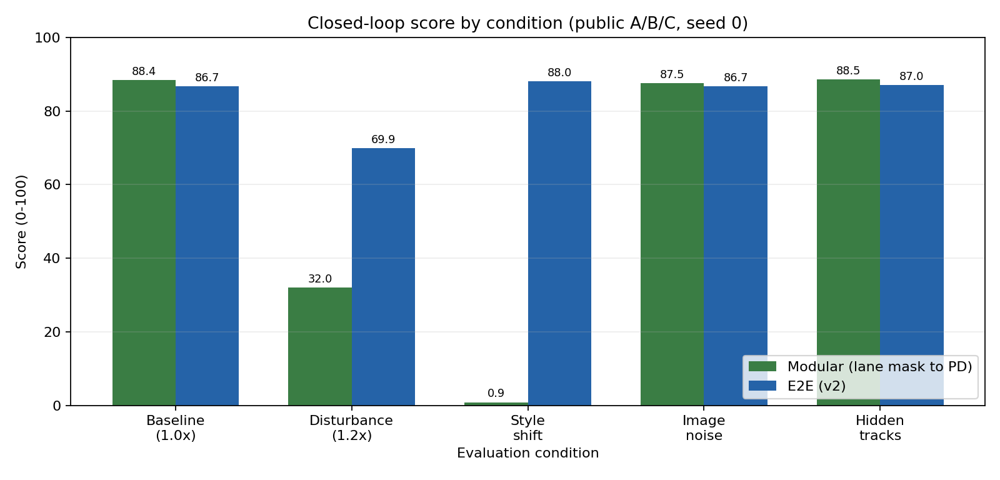

# 비교 리포트 - 202412328 이승윤 (8주차)

## 표 1. 정책 × 조건 폐루프 score (공개 A/B/C, 시드 0)
| 정책 | 기본 | 외란1.2x | 스타일 | 노이즈 | 미공개 |
|---|---|---|---|---|---|
| modular | 88.4 | 32.0 | 0.9 | 87.5 | 88.5 |
| e2e | 86.7 | 69.9 | 88.0 | 86.7 | 87.0 |
| multitask λ=0.5 | 87.6 |  |  |  |  |
| frame-stack | 86.6 |  |  |  |  |

## 그래프 1

## 해석 (5줄)

1. 어디서 누가 이겼나: 모듈형은 기본·노이즈·미공개에서 근소하게 높았고, E2E는 외란 1.2×와 스타일 변경에서 각각 37.9점과 87.1점 앞섰다.
2. 왜 (구조로 설명): 모듈형은 차선 마스크가 유지되면 추정 상태를 이용해 복구하지만 스타일 변경으로 고정 색 기준이 깨지면 오류가 PD 제어까지 전파되고, E2E는 학습한 영상 특징으로 이를 견뎠다.
3. 예상과 다른 칸: 예상과 달리 모듈형은 외란 1.2×에서 완주 수준을 유지하지 못해 32.0점으로 떨어졌고, 노이즈에서는 E2E보다 0.8점 높았다.
4. 내 챌린지 정책에 가져갈 것: 스타일 변화와 큰 외란에 강한 E2E를 기본 정책으로 사용하고 모듈형의 상태 추정값은 이탈 감시와 안전 제어에 활용하겠다.
5. 다음 실험: 시드를 3개로 늘리고 스타일 밝기와 외란 강도를 단계별로 바꾸어 각 정책의 성능 붕괴 임계값과 결과 분산을 확인하겠다.

## 체크

- [x] 두 정책 모두 이미지만 관측했으며 모듈형에 `env.state`를 주지 않았다.
- [x] 두 정책을 같은 트랙·외란·시드로 평가했다.
- [x] 표의 숫자에 근거해 해석을 작성했다.
- [x] 그래프에 조건 이름과 score 축을 표시했다.
